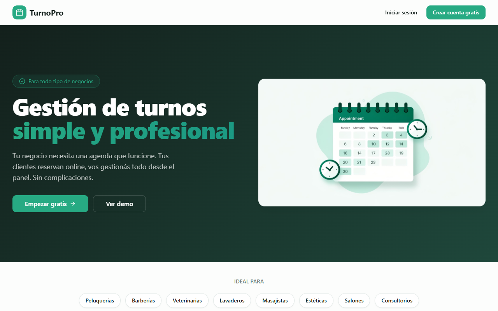

# TurnoPro

Turnos y reservas online para negocios de servicios (barberías, peluquerías, estética, consultorios): página pública de reserva, agenda, personal, horarios y confirmaciones/recordatorios por WhatsApp.



## Qué hace hoy

- **Reserva pública** en `/b/<slug>`: servicio → profesional (o "cualquiera") → día → horario → datos. Solo ofrece horarios libres según horario del negocio, horario de cada empleado, días bloqueados, duración del servicio, buffer entre turnos y anticipación mínima/máxima.
- **Autogestión del cliente** sin cuenta: link con token para ver, cancelar o reprogramar su turno.
- **Cobro sin pasarela**: alias/CVU, nota y QR que se muestran apenas el cliente reserva. No pasa plata por TurnoPro.
- **Panel del negocio**: inicio del día, agenda, servicios, personal, horarios y bloqueos (feriados o un empleado puntual), estadísticas semanales, configuración (logo, datos de cobro, reglas de agenda) y WhatsApp.
- **WhatsApp**: confirmación al reservar y recordatorio diario (cron) vía edge function `send-whatsapp`. Sin credenciales de Meta corre en modo **simulado** y deja el registro en el panel.

Lo que falta está en [`.planning/ROADMAP.md`](.planning/ROADMAP.md).

## Stack

React 18 + TypeScript + Vite 8, shadcn/ui sobre Radix, Tailwind, React Router, TanStack Query, Supabase (Postgres + Auth + Storage + Edge Functions + pg_cron), Vitest y pgTAP. Gestor de paquetes: **pnpm**.

## Estado de la base de datos: lista para activar, no activa

- **No hay ningún proyecto Supabase creado** (ni pago ni gratis). La app corre contra el stack local de la CLI de Supabase (Docker).
- El esquema son migraciones propias en `supabase/migrations/`: una baseline (`20261016000000_baseline.sql`) más los cambios posteriores. No queda nada del proyecto que armó Lovable (ver ADR-001 en [`docs/ARCHITECTURE.md`](docs/ARCHITECTURE.md)).
- `supabase/seed.sql` carga un negocio demo con servicios, personal, horarios y turnos alrededor de hoy. **Es solo para local**: crea un usuario directo en `auth.users`.

## Desarrollo local

Requisitos: Node 22+, pnpm, Docker Desktop corriendo.

```sh
pnpm install
pnpm db:start                 # levanta Postgres, Auth, Storage, etc. en Docker
pnpm exec supabase status     # copiá la "Publishable key"
cp .env.example .env          # y pegala en VITE_SUPABASE_PUBLISHABLE_KEY
pnpm dev                      # http://localhost:8080
```

- Demo pública: http://localhost:8080/b/demo
- Panel: http://localhost:8080/auth con `demo@turnopro.local` / `demo12345` (Barbería El Zorro). Segundo negocio vacío para probar aislamiento: `otro@turnopro.local` / `demo12345` (`/b/luna`)
- Mails de Auth (confirmación, reseteo): http://127.0.0.1:54324 (Mailpit)

Para probar WhatsApp/recordatorios en local también hace falta la edge function: `pnpm exec supabase functions serve`.

### Scripts

| Script | Qué hace |
| --- | --- |
| `pnpm dev` / `build` / `preview` | App |
| `pnpm lint` / `pnpm typecheck` | ESLint / `tsc` |
| `pnpm test` | Tests de la app (Vitest) |
| `pnpm db:start` / `db:stop` | Stack local de Supabase |
| `pnpm db:reset` | Borra la base **local**, aplica migraciones y seed |
| `pnpm db:test` | Tests de la base (pgTAP, `supabase/tests/`) |
| `pnpm db:types` | Regenera `src/integrations/supabase/types.ts` desde la base local |

### Cambiar el esquema

1. `pnpm exec supabase migration new <nombre>` y escribir el SQL. **Nunca editar una migración ya commiteada.**
2. Si es una regla de datos (permisos, restricciones, triggers), primero el test en `supabase/tests/` y verlo fallar con `pnpm db:test`.
3. `pnpm db:reset`, `pnpm db:test`, `pnpm db:types`, `pnpm typecheck`.

## Activar en un proyecto real (cuando se decida)

Nada de esto se hizo. Es la receta para el día que haga falta.

### Opción A — proyecto Supabase nuevo (recomendada)

1. Crear el proyecto en https://supabase.com/dashboard (región São Paulo, la más cercana a Argentina). El plan gratis alcanza para empezar.
2. Vincular y subir el esquema (**sin** el seed):
   ```sh
   pnpm exec supabase login
   pnpm exec supabase link --project-ref <project-ref>
   pnpm exec supabase db push
   ```
3. Edge function y sus secrets:
   ```sh
   pnpm exec supabase functions deploy send-whatsapp
   pnpm exec supabase secrets set SITE_URL=https://<dominio-de-la-app>
   ```
4. Secrets de Vault para el cron de recordatorios (SQL Editor del dashboard):
   ```sql
   select vault.create_secret('https://<project-ref>.supabase.co', 'project_url');
   select vault.create_secret('<anon/publishable key>', 'anon_key');
   ```
   Sin esto el cron apunta al Kong local y no envía nada.
5. Auth → URL Configuration: `Site URL` = dominio de la app, y agregarlo en Redirect URLs. Dejar activada la confirmación de email.
6. En el hosting del frontend (Vercel, Netlify, etc.): `VITE_SUPABASE_URL` y `VITE_SUPABASE_PUBLISHABLE_KEY` del proyecto (Project Settings → API). Build: `pnpm build`, carpeta `dist/`, con rewrite de todas las rutas a `index.html`.
7. Crear la primera cuenta desde `/auth` (el negocio se crea solo, por trigger).

WhatsApp real: cada negocio carga su `phone_number_id` y `access_token` de Meta Cloud API en el panel. Hasta entonces queda en modo simulado.

### Opción B — otro Postgres

No es plug-and-play: el esquema usa piezas propias de Supabase (`auth.users` y `auth.uid()` en RLS y triggers, `storage` para logos y QR, `vault`, `pg_net`, `pg_cron`, edge functions en Deno). La forma más corta es **Supabase self-hosted** (Docker, mismo esquema sin cambios). Sobre un Postgres pelado (Neon, RDS, etc.) habría que reemplazar Auth, Storage y la edge function por equivalentes y adaptar las policies; es un proyecto en sí.

## Seguridad

- Las filas de turnos son visibles para `anon` (para calcular horarios libres), pero las **columnas** con datos del cliente no: nombre, teléfono, email y notas solo los ve el dueño del negocio. Lo mismo con el contacto personal del staff.
- La reserva pública se valida entera en la base: estado, horarios, bloqueos, duración, buffer, anticipación (en hora del negocio), datos del cliente y que servicio y empleado sean del mismo negocio (ADR-004, ADR-007). `anon` no lee la tabla de turnos: la disponibilidad sale de un RPC.
- El negocio se crea con un trigger en `auth.users`, no desde el cliente.
- Los recordatorios solo los dispara el cron; ningún cliente puede ejecutarlos por la API.

Todo esto tiene tests en `supabase/tests/`. Decisiones y motivos en [`docs/ARCHITECTURE.md`](docs/ARCHITECTURE.md).
